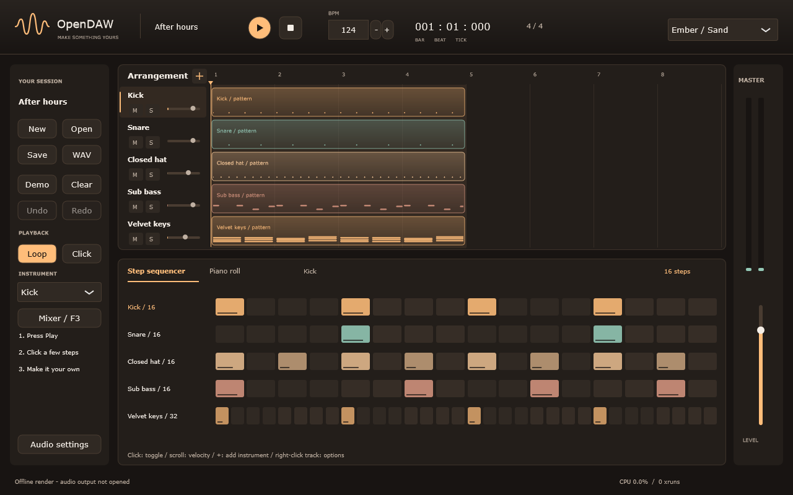

# OpenDAW

Оригинальная DAW для Windows. Сейчас это **первый инженерный срез**, а не готовая музыкальная станция.

Работает: нативное окно JUCE, авторская тёмная тема с тремя палитрами, состояние Play/Stop,
BPM 20–300, Space/Escape, модель музыкальных сущностей, пересчёт ticks в samples.
**Звука, редактирования нот, сохранения и экспорта пока нет.** Позиция транспорта не движется;
Play проверяет состояние будущего транспорта. Концепты показывают будущий интерфейс с примерными данными.
Владелец выбрал **C / Ember / Sand**: тема уже применена в приложении.



## Сборка Windows x64

Нужны Visual Studio 2022 C++ Build Tools, Windows SDK, CMake 3.22+, доступ к GitHub для первого получения JUCE.
JUCE **8.0.12** закреплён SHA-256; в систему не устанавливается. Условия: [матрица лицензий](docs/licenses.md).
Скрипт сам находит CMake в Visual Studio и ограничивает сборку одним потоком:

```powershell
.\scripts\build.ps1 -Configuration Debug
.\scripts\build.ps1 -Configuration Release
& '.\build\windows\OpenDAW_artefacts\Release\OpenDAW.exe'
```

После сборки можно дважды нажать `Запустить OpenDAW.cmd` в корне проекта.

Эквивалент, если CMake находится в PATH:

```powershell
$env:CMAKE_BUILD_PARALLEL_LEVEL = '1'
$env:_CL_ = '/MP1'
cmake -S . -B build/windows -G 'Visual Studio 17 2022' -A x64
cmake --build build/windows --config Debug --parallel 1
ctest --test-dir build/windows -C Debug --output-on-failure --parallel 1
```

Можно передать `-DOPENDAW_JUCE_PATH=<путь к JUCE 8.0.12>` для полностью локального конфигурирования.
Проверка ядра без JUCE: `.\scripts\build.ps1 -CoreOnly`.
GUI smoke-тест открывает окно примерно на секунду, проверяет транспорт/BPM/темы/геометрию и сохраняет
`build/windows/screenshots/opendaw.png`. Это снимок компонентов работающего приложения без рамки Windows.
Прохождение этого теста не подтверждает воспроизведение аудио, физический DPI и работу мышью.

## Документы

- [Архитектура и потоки](docs/architecture.md), [решение по стеку](docs/decisions/0001-stack.md).
- [План](docs/roadmap.md), [дневник и результаты](docs/daily-log.md), [требования](docs/requirements.md).
- [GitHub и ежедневные коммиты](docs/github-workflow.md).
- [Тема](docs/design-system.md), [компоновка](docs/ui-layout.md), [концепты](docs/visual-asset-requests.md).
- [Будущий сайт](docs/website-brief.md) — отдельный этап после рабочей версии.
- [Оценка REA](docs/rea-assessment.md), [исследование](docs/research.md), [лицензии](docs/licenses.md).

Исходный план сохранён в [docs/master-plan.md](docs/master-plan.md). Лицензия собственного кода пока не выбрана.
Никакие бинарники и исходники сторонних DAW не копируются.
Создан публичный репозиторий: [kyouki-ai/OpenDAW](https://github.com/kyouki-ai/OpenDAW).
Первичная отправка кода пока отклонена GitHub: для `.github/workflows/windows.yml`
нужно отдельно согласованное разрешение GitHub CLI `workflow`. Первый коммит сохранён локально.
