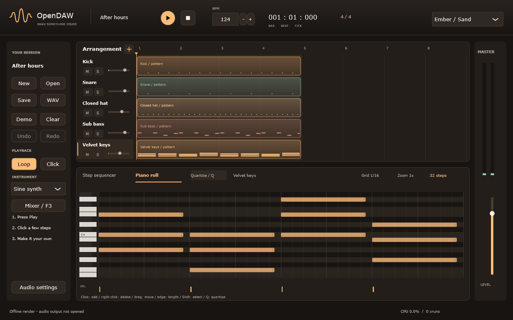

# Первый трек в OpenDAW

После запуска открыт демопроект **After hours**: ударные, бас и аккорды.
Нажми круглую Play или пробел. Escape останавливает и возвращает позицию в начало.

## Собери ритм

Во вкладке **Step sequencer** нажимай клетки: заполненная клетка играет ноту.
Колесо над шагом меняет силу удара. Если дорожек больше, чем помещается в окно,
колесо прокручивает список, а Shift+колесо меняет силу удара.
Число шагов в заголовке переключает длину выбранного паттерна между 16 и 32.

Кнопка **+** рядом с Arrangement добавляет инструмент. Ctrl+T сразу создаёт sine synth.
Правой кнопкой по имени дорожки можно переименовать, скопировать или удалить её.
Копия получает собственные ноты: редактирование не меняет исходную дорожку.

## Нарисуй мелодию

Выбери дорожку и открой **Piano roll**. Щелчок по сетке добавляет ноту,
правая кнопка удаляет. Перетаскивай ноту, а за правый край меняй её длину.
Shift+щелчок добавляет ноты к выделению; Ctrl+A выделяет все.

Стрелки двигают выделение. Shift+Up/Down переносит его на октаву,
Shift+Left/Right меняет длину. Ctrl+C/V копирует и вставляет, Ctrl+D дублирует.
Нижние столбики меняют velocity. **Grid** задаёт сетку, Ctrl+колесо — масштаб,
Shift+колесо — прокрутку времени, обычное колесо — высоту нот.

Чтобы поправить ритм, выдели ноты и нажми **Quantize / Q**. Начала нот выровняются
по ближайшим делениям выбранной **Grid**. Длительность, высота и velocity сохранятся;
ноты останутся внутри паттерна. Ctrl+Z возвращает исходный ритм.

## Собери композицию

Клипы в **Arrangement** повторяют паттерны. Перетаскивай их по времени или на
другую дорожку. Правый край задаёт длину; Shift+щелчок создаёт копию,
правая кнопка удаляет клип. Щелчок по пустому месту добавляет основной паттерн дорожки.

Щелчок по линейке переносит позицию. Shift+перетаскивание выбирает loop.
Выключи **Loop**, чтобы проиграть всю аранжировку. Ctrl+колесо меняет масштаб.

## Настрой звук и сохрани

F3 открывает **Mixer**: volume, pan, mute/solo, input gain и low-pass на каждом канале.
Кнопка Low-pass включает фильтр; ручка под ней меняет частоту среза.
**Audio settings** выбирает output-устройство, частоту и размер буфера.

F2 переименовывает сессию. Ctrl+S сохраняет проект `.opendaw`,
Ctrl+Shift+S выбирает новый файл, Ctrl+O открывает сохранённый проект.
Ctrl+E экспортирует стерео WAV 24-bit / 48 kHz. Проект сохраняет возможность редактирования;
WAV содержит готовый звук. Ctrl+Z отменяет действие, Ctrl+Y повторяет.

Незавершённая работа получает контрольную копию каждые 30 секунд.
После нештатного закрытия OpenDAW предложит восстановить её.

[О проекте](../README.md) · [Разработка и сборка](../CONTRIBUTING.md)
